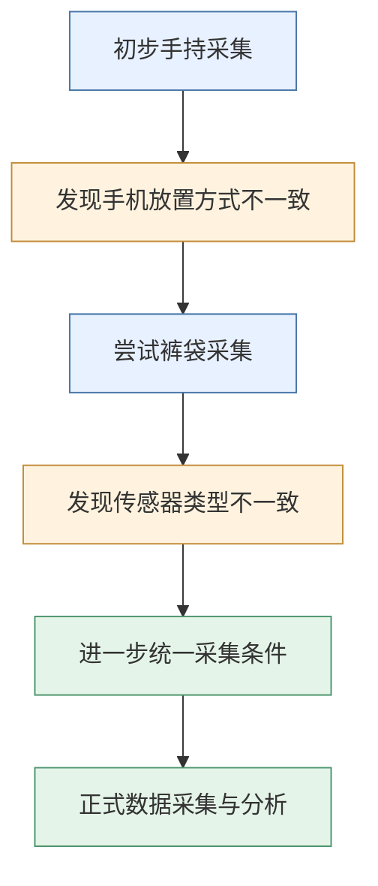

# Gait Analysis System

**多姿态步态加速度特征采集与对比**

A reproducible experimental project for gait acceleration data collection, signal processing, feature extraction, and motion pattern comparison.

---

## 1. Project Overview（项目概述）

### 1.1 项目背景

本项目以智能手机内置加速度传感器为数据采集工具，使用 Phyphox 记录人体在不同运动状态下的加速度信号。

通过对采集数据进行整理、质量检查、预处理、特征提取和可视化，探索不同运动状态下加速度信号的变化规律及其特征差异。

项目不仅关注最终的数据分析结果，也重视实验过程的真实性、数据管理的规范性以及实验结果的可追溯性。

### 1.2 研究目标

- 采集不同运动状态下的加速度数据。
- 建立规范、可追溯的实验数据管理流程。
- 检查不同采集条件对数据质量的影响。
- 分析不同运动状态下的加速度信号特征。
- 提取具有分析价值的时域和频域特征。
- 探索不同运动状态的特征对比与区分方法。

### 1.3 研究问题

1. 不同运动状态下的加速度信号具有哪些变化特征？
2. 手机放置位置和姿态是否会影响采集结果？
3. 包含重力加速度的数据与去除重力影响的数据有什么区别？
4. 哪些时域和频域特征有助于区分不同运动状态？
5. 如何通过规范的数据采集与处理提高实验结果的可靠性？

---

## 2. Experimental Categories（实验类别）

计划研究的运动状态包括：

| 类别 | 英文名称 | 实验说明 |
|---|---|---|
| 静止 | Static | 人体保持静止 |
| 平地正常行走 | Normal Walking | 平地正常速度行走 |
| 快跑 | Running | 按实验方案规定的速度跑步 |
| 上楼梯 | Stair Ascent | 沿楼梯向上行走 |
| 下楼梯 | Stair Descent | 沿楼梯向下行走 |

注：以上为计划研究的类别。实际数据是否齐全、是否符合正式实验条件，以数据登记表和实验记录为准。其他探索性动作数据应单独标注，不直接与上述类别混淆。

---

## 3. Experimental Tools（实验工具）

### 3.1 数据采集与分析工具

- **Android Smartphone**：加速度数据采集设备。
- **Phyphox**：传感器数据采集软件。
- **Python**：数据处理、特征提取和可视化。
- **GitHub**：项目版本管理、实验文档和数据归档。

### 3.2 AI-assisted Tools（AI辅助工具）

本项目使用以下 AI 工具辅助实验与工程实践：

- ChatGPT
- DeepSeek
- Qwen
- WorkBuddy

AI 工具主要用于实验方案讨论、技术问题排查、资料整理、代码辅助和文档编写。

AI 生成的内容均需要人工核查。实验事实、数据结果和最终结论以实际实验及验证结果为准。

相关使用记录见 `ai_collaboration/`。

---

## 4. Experimental Workflow（实验工作流程）

本项目采用以下工作流程：

1. Requirements Analysis：任务要求分析
2. Experimental Design：实验方案设计
3. Data Collection：实验数据采集
4. Data Quality Assessment：数据质量检查
5. Data Preprocessing：数据预处理
6. Feature Extraction：特征提取
7. Data Visualization：数据可视化
8. Comparative Analysis：特征对比分析
9. Result Evaluation：结果评估
10. Final Report：实验报告整理

---

## 5. Experimental Iteration（实验迭代）

本项目保留从初步探索到实验方案改进的过程，记录实验中发现的问题、调整措施和后续验证情况。

### 5.1 实验迭代流程

注：该图展示实验迭代的整体思路，不代表所有阶段均已完成。具体实验时间、数据和方案调整情况以实验日志及原始数据记录为准。

### 5.2 实验过程记录

实验过程中重点记录：

- 不同实验轮次的采集方式。
- 手机放置位置和姿态的调整。
- 传感器类型和采集参数的变化。
- 实验过程中发现的问题。
- 实验方案的修改原因。
- 数据筛选和排除的依据。
- 补测前后的实验条件与数据变化。

早期数据不会因为不符合后续实验规范而被随意删除，而是保留原始文件和实验背景，并根据采集条件分类管理。

详细记录见 `experiment/`。

---

## 6. Data Management（数据管理）

项目采用分层数据管理方式：

| 数据目录 | 内容 |
|---|---|
| `data/raw/` | 原始采集数据 |
| `data/interim/` | 中间处理数据 |
| `data/processed/` | 经过规范处理的数据 |
| `data/selected/` | 正式分析选用的数据 |
| `data/metadata/` | 数据登记表、采集条件及元数据 |

### 6.1 数据管理原则

1. 原始数据尽可能保持不变。
2. 保留原始文件名和数据来源。
3. 不同动作、手机放置方式和传感器类型分别标注。
4. 处理后的数据应能追溯到原始文件。
5. 正式分析数据应有明确的筛选依据。
6. 异常数据和未采用数据应记录原因。
7. 不将不同采集条件的数据未经评估直接混合分析。

### 6.2 数据追溯

每份正式分析数据尽可能关联：

- 原始数据文件。
- 实验编号。
- 实验采集条件。
- 对应实验日志。
- 对应视频证据（如果有）。
- 数据处理方法及处理结果。

---

## 7. Experimental Evidence（实验过程证据）

为提高实验过程的真实性、透明度和可追溯性，本项目对部分实验操作进行视频记录，并将视频作为实验过程的辅助证据进行归档。

### 7.1 视频记录内容

视频记录可能包括：

- Phyphox 传感器实验的设置过程。
- 手机放置方式及实验设备状态。
- 静止、正常行走、快跑和上下楼梯等动作的实际采集过程。
- 实验操作过程中出现的问题及调整过程。
- 后续补测和实验方案改进过程。

### 7.2 视频与数据的对应关系

为了方便核查，每段视频尽可能关联对应的实验编号和原始数据文件。

视频档案登记信息包括：

| 字段 | 说明 |
|---|---|
| Video ID | 视频编号 |
| Recording Date | 录制日期 |
| Experiment ID | 对应实验编号 |
| Motion Type | 运动类别 |
| Related Data | 对应原始数据文件 |
| Description | 视频内容说明 |

### 7.3 证据管理原则

1. 保留原始视频，不随意剪辑或覆盖。
2. 如需剪辑用于展示，应同时保留原始视频。
3. 视频记录与实验日志、原始数据建立对应关系。
4. 不使用摆拍或后期制作的视频冒充真实实验记录。
5. 对无法确认的视频时间、实验条件和数据对应关系，如实标注待核实。

视频档案目录：`evidence/videos/`

视频文件较大时，可使用 Git LFS 或其他可访问的存储方式，并在仓库中保留视频索引和访问说明。

---

## 8. AI Collaboration Records（AI协作记录）

为保证 AI 辅助过程透明、可追溯，本项目单独保存 AI 协作档案。

记录内容包括：

- AI 工具名称及可获取的模型版本。
- 对话日期和任务目的。
- 用户提示词及 AI 回复。
- AI 输出的使用情况。
- 人工核验与修改过程。
- 最终方案是否采纳及其原因。

完整档案见 `ai_collaboration/`。

AI 输出不直接作为实验结论或未经验证的技术依据。所有关键实验决策和最终分析结果均需要结合实际数据进行人工核查。

---

## 9. Project Documentation（项目文档）

### 9.1 项目设计

- [项目概述](docs/project_overview.md)
- [任务要求](docs/requirements.md)
- [实验设计](docs/experimental_design.md)
- [数据采集规范](docs/data_collection_protocol.md)
- [数据字典](docs/data_dictionary.md)
- [数据质量标准](docs/data_quality_criteria.md)

### 9.2 实验过程

- [实验日志](experiment/experiment_log.md)
- [实验迭代历史](experiment/trial_history.md)
- [问题与解决记录](experiment/troubleshooting.md)
- [实验方案变更记录](experiment/protocol_changes.md)
- [关键决策记录](experiment/decision_log.md)

### 9.3 实验过程证据

- [证据档案说明](evidence/README.md)
- [证据索引表](evidence/evidence_index.csv)

### 9.4 AI协作

- [AI协作档案](ai_collaboration/README.md)
- [AI工具登记表](ai_collaboration/ai_tools_registry.md)

### 9.5 数据与分析

- [数据登记表](data/metadata/dataset_inventory.csv)
- [最终实验报告](docs/final_report.md)

注：上述链接需要在对应文件创建后才能正常访问。

---

## 10. Reproducibility and Quality Control（可复现性与质量控制）

为了提高实验过程的可追溯性和分析结果的可靠性，本项目逐步建立以下规范：

- 记录实验设备和软件环境。
- 记录采集条件和实验操作。
- 保留原始数据及其元数据。
- 记录数据清洗和特征提取步骤。
- 对分析代码进行必要的测试。
- 保留实验方案变更和重要决策记录。
- 区分探索性分析与正式分析。
- 将实验视频、原始数据和实验日志建立对应关系。

项目最终分析应尽可能能够从原始数据、处理代码和实验记录中复现。

---

## 11. Project Status（项目状态）

**当前阶段：最终交付收尾。**

项目已包含实验历史、数据元数据、质量审计、静止组分析及走路组阶段性复核材料。走路组11条记录仍有待最终纳入判断；视频逐文件映射尚未全部确认；最终报告与远端验收仍需完成。不得将候选关联或候选区间表述为已确认结果。

交付清单与当前限制见[课题08仓库交付状态与最后检查清单](docs/DELIVERY_STATUS.md)。

---

## 12. Project Principles（项目原则）

- **Scientific Integrity**：尊重实验事实。
- **Data Traceability**：保证数据可追溯。
- **Reproducibility**：重视实验可复现性。
- **Transparency**：如实记录失败与改进。
- **Human Verification**：人工核验 AI 辅助内容。
- **Version Control**：通过 Git 提交记录管理项目变化。

---

**Project Name:** Gait Analysis System  
**Course Topic:** 课题08  
**Project Type:** Experimental Data Collection and Analysis  
**Status:** In Progress
