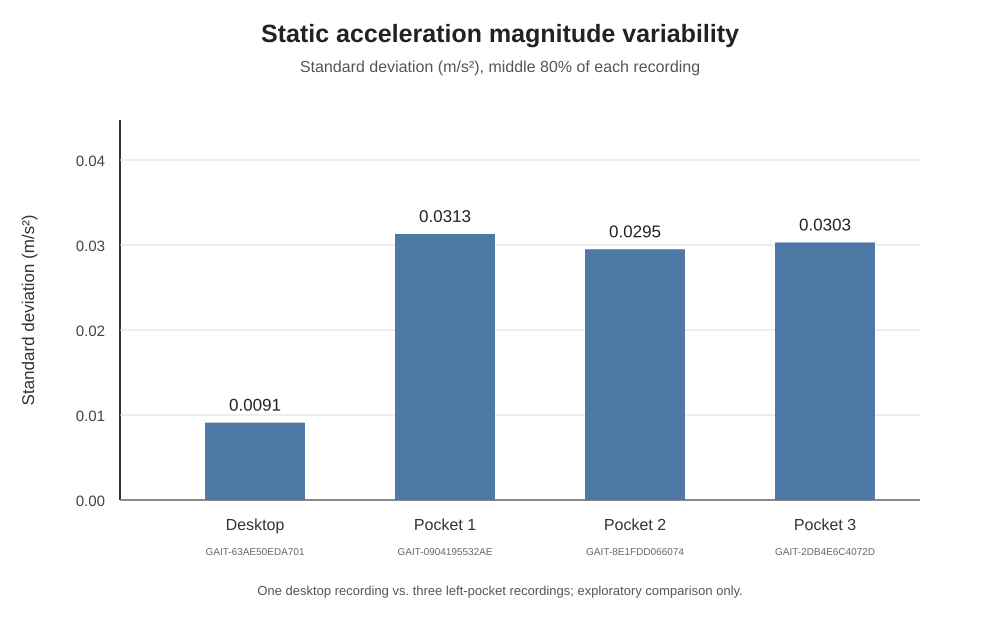

# 静止状态下桌面与左裤袋加速度波动对比

## 1. 分析目的

比较手机处于桌面静止状态和左裤袋静止状态时，加速度信号的波动情况。本次为探索性对比，不将结果直接推广到其他设备或场景。

## 2. 数据来源

纳入 4 组总加速度（包含重力加速度）数据，采样率均约为 500 Hz。

| 条件 | 数据集编号 | 放置位置 | 原始文件 |
|---|---|---|---|
| 桌面静止 | GAIT-63AE50EDA701 | 桌面 | g+2026-10-22+09-00-50静止3.zip |
| 裤袋静止 1 | GAIT-0904195532AE | 左裤袋 | 站立姿势手机放口袋，电脑测试.zip |
| 裤袋静止 2 | GAIT-8E1FDD066074 | 左裤袋 | 站立手机放口袋电脑控制.zip |
| 裤袋静止 3 | GAIT-2DB4E6C4072D | 左裤袋 | 站立放口袋，电脑控制.zip |

桌面组目前纳入 1 组，左裤袋组纳入 3 组。重复 ZIP 副本不作为独立实验组。

## 3. 数据处理方法

1. 读取每组 ZIP 中的 `Raw Data.csv`。
2. 使用三轴加速度及其加速度模长进行统计。
3. 本节所列探索性对比统计截取每组数据中间 80% 的样本，降低采集开始和结束阶段可能存在的边缘影响。
4. 对加速度模长计算均值、标准差、峰峰值和 RMS。
5. 统计结果保留 4 位小数。

加速度模长：

\[
a=\sqrt{a_x^2+a_y^2+a_z^2}
\]

标准差描述信号围绕均值的离散程度；峰峰值为最大值与最小值之差；RMS 为均方根值。

**统计口径说明：** 本节中间 80% 统计是早期探索性对比口径。后续针对裤袋③开展的异常复核，另外计算了完整记录和从 3 秒起的稳定片段，统计区间不同，数值不可直接混为同一组结果。分段结果见 [裤袋静止异常复核报告](pocket_static_outlier_review.md) 和 [复核指标 CSV](static_pocket_signal_review_metrics.csv)。

## 4. 统计结果（中间 80% 样本）

| 条件 | 数据集编号 | 模长均值 (m/s²) | 标准差 (m/s²) | 峰峰值 (m/s²) | RMS (m/s²) |
|---|---|---:|---:|---:|---:|
| 桌面静止 | GAIT-63AE50EDA701 | 9.8387 | 0.0091 | 0.1820 | 9.8387 |
| 裤袋静止 1 | GAIT-0904195532AE | 9.7440 | 0.0313 | 0.4652 | 9.7441 |
| 裤袋静止 2 | GAIT-8E1FDD066074 | 9.7310 | 0.0295 | 0.2184 | 9.7310 |
| 裤袋静止 3 | GAIT-2DB4E6C4072D | 9.8807 | 0.0303 | 0.4522 | 9.8807 |

## 5. 可视化结果

图中比较四组数据的加速度模长标准差，单位为 m/s²。图表应与本目录中的 CSV 统计表配套阅读。

## 6. 初步分析

- 当前桌面静止数据的加速度模长波动较小。
- 按本节中间 80% 的统计口径，三组左裤袋静止数据的标准差约为 0.0295–0.0313 m/s²，高于桌面组的 0.0091 m/s²。
- 三组裤袋数据在该统计口径下的标准差比较接近，但峰峰值存在差异。
- 手机在裤袋中可能受到人体微小动作、衣物接触或放置姿态变化等因素影响；这些只是可能解释，尚未通过独立实验验证。
- 桌面和裤袋中的手机姿态可能不同，因此不能仅根据 X、Y、Z 三轴均值判断哪种放置方式更稳定。
- 后续异常复核发现裤袋③开头约 0–3 秒存在明显波动；完整记录与 3 秒起稳定片段的结果另行记录，不用中间 80% 的旧统计替代该分段复核。

## 7. 局限性

1. 桌面静止目前只有 1 组，裤袋静止有 3 组，样本数量不平衡。
2. 本次结果仅反映当前设备和采集条件下的观察结果。
3. 已生成四组数据的三轴时域对比图；频域特征对比仍待开展。
4. 本节统计使用中间 80% 样本；其他分析若采用不同区间，应明确标注处理范围并保留版本记录。
5. 对裤袋③开头波动的具体成因，目前没有足够的独立过程证据作出确定判断。

因此，本次结果属于初步探索性分析，不能据此认定所有桌面静止实验都比裤袋静止实验稳定。

## 8. 后续工作

- 补充桌面静止重复采集，改善样本数量不平衡问题。
- 在明确统计区间的基础上继续开展频域特征分析。
- 对不同传感器类型的数据分别分析，避免将含重力数据与线性加速度数据直接混合。
- 继续分析正常行走、跑步和上下楼梯等动态数据。
- 保留处理代码、统计表、异常复核记录和图表版本，确保分析过程可追溯。

## 9. 相关文件

- [`static_comparison_metrics.csv`](static_comparison_metrics.csv)：本节中间 80% 探索性对比的统计指标表。
- [`figures/acceleration_magnitude_std_comparison.svg`](figures/acceleration_magnitude_std_comparison.svg)：加速度模长标准差对比图。
- [`pocket_static_outlier_review.md`](pocket_static_outlier_review.md)：裤袋③异常波动复核与片段纳入状态。
- [`static_pocket_signal_review_metrics.csv`](static_pocket_signal_review_metrics.csv)：三组裤袋静止数据全程及分段统计指标。
- [`static_pocket_review_process.md`](static_pocket_review_process.md)：异常复核过程记录。
- [`csv_quality_audit_report.md`](csv_quality_audit_report.md)：CSV 基础结构审计报告。
- [`source_file_verification.md`](source_file_verification.md)：原始 ZIP 身份、SHA256 和 CSV 结构核验记录。
